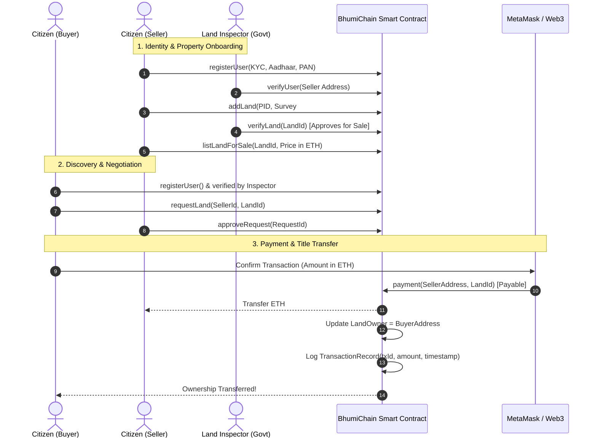

<div align="center">

# 🏛️ BhumiChain (भूमिChain)
### *Decentralized Land Title Registration & Real Estate Escrow System*

[](https://soliditylang.org/)
[](https://ethereum.org/)
[](https://reactjs.org/)
[](https://web3js.readthedocs.io/)
[](https://trufflesuite.com/)
[](https://metamask.io/)
[](LICENSE)

<br/>

**A transparent, tamper-proof, and decentralized land registry prototype built on Ethereum smart contracts to eliminate title fraud, prevent double-selling, and automate property ownership transfers.**

[Explore Features](#-key-features) • [System Workflow](#-system-workflow) • [UI Gallery](#-ui-showcase--gallery) • [Quick Start](#-quick-start-guide) • [Smart Contract](#-smart-contract-architecture)

---

</div>

> [!NOTE]
> **Academic Prototype:** BhumiChain is developed as a final-year engineering capstone project. It simulates decentralized land governance on a local Ethereum blockchain (Ganache). Read the [Privacy and Security Limitations](#-privacy--security-limitations) before handling any real assets or private identity data.

---

## 📑 Table of Contents

- [📌 Overview & Problem Statement](#-overview--problem-statement)
- [✨ Key Features](#-key-features)
- [🔄 System Workflow](#-system-workflow)
- [🖥️ UI Showcase & Gallery](#-ui-showcase--gallery)
- [🏗️ System Architecture & Tech Stack](#-system-architecture--tech-stack)
- [📜 Smart Contract Architecture](#-smart-contract-architecture)
- [🚀 Quick Start Guide](#-quick-start-guide)
  - [Prerequisites](#prerequisites)
  - [Option A: One-Click Startup (Windows)](#option-a-one-click-startup-windows)
  - [Option B: Step-by-Step Manual Setup](#option-b-step-by-step-manual-setup)
  - [MetaMask Configuration](#metamask-configuration)
- [📂 Repository Structure](#-repository-structure)
- [🔒 Privacy & Security Limitations](#-privacy--security-limitations)
- [🗺️ Future Roadmap](#️-future-roadmap)
- [👥 Project Information & Authors](#-project-information--authors)
- [📄 License](#-license)

---

## 📌 Overview & Problem Statement

Traditional land registries worldwide suffer from bureaucratic bottlenecks, non-transparent paper records, unauthorized tampering, and severe ownership disputes. 

| Challenge in Traditional Land Registry | How BhumiChain Solves It |
| :--- | :--- |
| **Tampered Deeds & Forgery** | Deeds are immutably minted onto the Ethereum ledger; records cannot be modified without cryptographic consensus. |
| **Double Selling of Land** | A seller cannot list or transfer land unless their ownership is verified on-chain, and transferred assets instantaneously change ownership. |
| **Middlemen & High Brokerage** | Peer-to-peer property marketplace enables buyers and sellers to interact directly with transparent pricing. |
| **Opaque Bureaucratic Approvals** | All government inspector approvals and rejection reasons are permanently logged on-chain. |
| **Slow Settlement Cycles** | Smart contract automated escrow executes fund transfer and deed reassignment in a single atomic transaction. |

---

## ✨ Key Features

### 🏛️ 1. Government Land Inspector Portal (Authority)
- **Identity Verification:** Inspects citizen KYC details (Aadhaar, PAN, identity documents) and either approves or rejects with a documented reason.
- **Land Title Legal Clearance:** Verifies physical survey numbers, Property PID, geo-location, and deed documents before granting listing permission.
- **Global Transaction Ledger:** Real-time visibility into all land sales, transferred titles, and historical records across the municipality.
- **Emergency Dispute Override:** Dedicated administrative function to transfer title in legal arbitration cases.

### 👤 2. Unified Citizen Portal (Buyer & Seller)
- **Single Account Multi-Role:** No separate buyer/seller logins. Any verified citizen can both purchase new land and list owned parcels for sale.
- **Property Registration:** Submit parcel information including Area (sq ft), City, State, Property Identification Number (PID), Physical Survey Number, and IPFS document references.
- **P2P Real Estate Marketplace:** Explore verified lands across states and cities with transparent pricing in ETH.
- **Interactive Offer Management:** 
  - Submit purchase offers to property owners.
  - Track outgoing offers in real time (`Pending`, `Accepted`, `Rejected`).
  - Property owners can accept or reject incoming purchase requests.
- **Instant Web3 Title Settlement:** Buyer pays seller directly via MetaMask; the smart contract validates the funds and automatically updates the recorded owner on-chain with zero manual paperwork.
- **Proof of Ownership & Audit Trail:** Search any parcel ID to view its complete provenance and timestamped ownership history.

---

## 🔄 System Workflow



---

## 🖥️ UI Showcase & Gallery

<div align="center">

### Authentication & Authority Dashboards

| User Registration & Login | Land Inspector Portal |
| :---: | :---: |
|  |  |
| *Unified registration for buyers & sellers* | *Authorized government land officer gateway* |

| Land Inspector Dashboard | Land Records & Approvals |
| :---: | :---: |
|  |  |
| *Real-time metrics: Users, Lands, Requests, and Tx counts* | *Verification panel for parcel survey numbers & title deeds* |

### Property Management & Marketplace

| Register a Property | Verified Property Marketplace |
| :---: | :---: |
|  |  |
| *Add parcel details: Area, PID, Survey Number, Price* | *Browse government-approved parcels available for purchase* |

### Web3 Transactions & Blockchain Ledger

| Multi-Account MetaMask Setup | Transaction Signing & Payment |
| :---: | :---: |
|  |  |
| *Configured with Ganache test accounts (Inspector, Seller, Buyer)* | *Instantaneous ETH payment signed on MetaMask* |

| Immutable Blockchain Ledger | On-Chain Transaction Receipt |
| :---: | :---: |
|  |  |
| *Permanent audit log of every land title transfer* | *Detailed block receipt: Land ID, Seller, Buyer, ETH value, Timestamp* |

</div>

---

## 🏗️ System Architecture & Tech Stack

```
┌─────────────────────────────────────────────────────────────┐
│                       Client Tier                           │
│  React 17  •  Reactstrap / Bootstrap  •  Web3.js Provider   │
└──────────────────────────────┬──────────────────────────────┘
                               │ JSON-RPC (HTTP)
                               ▼
┌─────────────────────────────────────────────────────────────┐
│                      Blockchain Tier                        │
│  Ganache Local Node (Port 7545, Net ID 5777, Chain ID 1337) │
│                                                             │
│   ┌─────────────────────────────────────────────────────┐   │
│   │             Land.sol Smart Contract                 │   │
│   │  • Unified User Mapping   • Land Registry Mapping   │   │
│   │  • Offer / Request Engine • Automated Escrow Tx     │   │
│   │  • Inspector Role Guard   • Immutable Tx Ledger     │   │
│   └─────────────────────────────────────────────────────┘   │
└─────────────────────────────────────────────────────────────┘
```

| Layer | Technologies & Tools |
| :--- | :--- |
| **Smart Contracts** | Solidity (`0.5.16`), Truffle Suite, ABIEncoderV2 |
| **Local Blockchain** | Ganache CLI / Ganache GUI (Port `7545`, Chain ID `1337`) |
| **Client Frontend** | React.js (`17.0.2`), React Router (`5.2.0`), Reactstrap / Bootstrap 4, Black Dashboard Theme |
| **Web3 Provider** | Web3.js (`1.2.2`), MetaMask Wallet Extension |
| **Build & Tooling** | Node.js (14 / 16 recommended), npm / yarn, Windows Batch Automations |

---

## 📜 Smart Contract Architecture

The core logic resides in [`contracts/Land.sol`](contracts/Land.sol):

### Core Data Models

```solidity
struct Landreg {
    uint id;
    uint area;
    string city;
    string state;
    uint landPrice;
    uint propertyPID;
    uint physicalSurveyNumber;
    string ipfsHash;
    string document;
}

struct User {
    address id;
    string name;
    uint age;
    string city;
    string aadharNumber;
    string panNumber;
    string document;
    string email;
}

struct LandRequest {
    uint reqId;
    address sellerId;
    address buyerId;
    uint landId;
}

struct TransactionRecord {
    uint txId;
    uint landId;
    address seller;
    address buyer;
    uint amount;
    uint timestamp;
}
```

### Essential Smart Contract Operations

| Method | Access | Description |
| :--- | :---: | :--- |
| `registerUser(...)` | Public | Enrolls a citizen wallet with identity data (simultaneously enables buyer & seller roles). |
| `verifyUser(address)` | Inspector Only | Verifies a citizen's KYC documents to unlock parcel listing and bidding. |
| `rejectUser(address, reason)` | Inspector Only | Rejects a citizen profile with an on-chain reason string. |
| `addLand(...)` | Verified User | Registers a new parcel with Survey # and PID (initially unverified). |
| `verifyLand(uint landId)` | Inspector Only | Grants legal verification to a parcel and authorizes it for marketplace listing. |
| `listLandForSale(uint, price)`| Land Owner | Puts verified parcel up for sale on the marketplace. |
| `requestLand(seller, landId)` | Verified User | Submits a formal purchase offer to the property owner. |
| `approveRequest(uint reqId)` | Land Owner | Accepts an incoming purchase offer, authorizing payment. |
| `payment(seller, landId)` | Buyer (Payable) | Transmits ETH to the seller and **atomically reassigns deed ownership** on-chain. |

---

## 🚀 Quick Start Guide

### Prerequisites

Ensure you have the following installed on your machine:
- **Node.js** (v14.x or v16.x LTS recommended for React 17 / web3 compatibility)
- **Truffle & Ganache** installed globally:
  ```powershell
  npm install -g truffle ganache
  ```
- **MetaMask** extension installed in Chrome, Edge, or Brave.

---

### Option A: One-Click Startup (Windows)

The repository provides automated batch scripts for quick local launches:

1. **Launch Everything:**
   Double-click [`run-project.bat`](run-project.bat) to spin up Ganache and start the React application in separate windows.
2. **Deploy Contracts (First-time or Reset):**
   Double-click [`deploy-contracts.bat`](deploy-contracts.bat) to compile and deploy `Land.sol` onto Ganache.

---

### Option B: Step-by-Step Manual Setup

#### 1. Clone the repository
```bash
git clone https://github.com/vivekpunde/Land-Registration-with-Blockchain.git
cd Land-Registration-with-Blockchain
```

#### 2. Install dependencies
```bash
# Install client packages
cd client
npm install
cd ..
```

#### 3. Start Ganache Local Blockchain
In a separate terminal, launch a deterministic Ganache instance:
```powershell
ganache --port 7545 --chain.networkId 5777 --chain.chainId 1337 --wallet.mnemonic "candy maple cake sugar pudding cream honey rich smooth crumble sweet treat"
```
*(Or launch Ganache Desktop configured for Port `7545` and Network ID `5777`)*

#### 4. Compile & Deploy Smart Contracts
From the root directory:
```powershell
truffle compile
truffle migrate --reset
```
> The deployer account (Account #0) automatically becomes the designated **Land Inspector**.

#### 5. Launch the Web Application
```powershell
npm start
```
The React frontend will launch at: [http://localhost:3000](http://localhost:3000)

---

### MetaMask Configuration

1. In MetaMask, go to **Settings > Networks > Add Network (Manually)**:

| Parameter | Recommended Value |
| :--- | :--- |
| **Network Name** | Ganache Localhost |
| **New RPC URL** | `http://127.0.0.1:7545` |
| **Chain ID** | `1337` |
| **Currency Symbol** | `ETH` |

2. **Import Test Accounts:**
   - Account `0` (Deployer) → **Land Inspector**
   - Account `1` → **Citizen A (Seller)**
   - Account `2` → **Citizen B (Buyer)**
   
   *(Copy private keys directly from Ganache CLI output or Ganache Desktop interface)*

---

## 📂 Repository Structure

```text
Land-Registration-with-Blockchain/
├── contracts/
│   ├── Land.sol                # Core Solidity smart contract
│   └── Migrations.sol          # Truffle deployment migration helper
├── migrations/
│   ├── 1_initial_migration.js  # Migration script 1
│   └── 2_deploy_contracts.js   # Deploys Land.sol & updates frontend artifacts
├── client/
│   ├── public/                 # Static public assets & screenshots
│   └── src/
│       ├── artifacts/          # Compiled ABI & contract deployment metadata
│       ├── components/         # Reusable UI widgets, Navbars, Footers
│       ├── layouts/            # Role-specific layouts (Admin, User, Inspector)
│       ├── views/              # Feature pages
│       │   ├── LIDashboard.js          # Land Inspector metrics & overview
│       │   ├── LandApprovals.js        # Government verification queue
│       │   ├── UserInfo.js             # Citizen KYC verification view
│       │   ├── UserDashboard.js        # Citizen dashboard
│       │   ├── AddLand.js              # Property registration form
│       │   ├── Marketplace.js          # Property marketplace
│       │   ├── MyLands.js              # Owned land listings & sale toggle
│       │   ├── IncomingRequests.js     # Incoming purchase offers
│       │   ├── SentRequests.js         # Sent purchase offers
│       │   └── TransactionHistory.js   # On-chain deed transaction ledger
│       ├── routesUser.js       # Citizen portal routing definitions
│       ├── routesLI.js         # Land Inspector routing definitions
│       └── getWeb3.js          # MetaMask Web3 connector
├── test/
│   └── land.js                 # Smart contract test suite
├── deploy-contracts.bat        # Windows automation: Truffle compile & migrate
├── run-project.bat             # Windows automation: 1-click full stack runner
├── start-blockchain.bat        # Windows automation: Ganache local chain runner
├── start-client.bat            # Windows automation: React client runner
├── truffle-config.js           # Truffle compiler & network configuration
├── package.json                # Root package configuration
└── README.md                   # Project documentation
```

---

## 🔒 Privacy & Security Limitations

> [!WARNING]
> This codebase is an educational capstone project and proof-of-concept. It is not audited for real-world legal enforceability, production custody, or mainnet deployment.

- **On-Chain Personal Data:** Aadhaar and PAN numbers are written to the blockchain in plain text. Public blockchains are globally readable and immutable; **never use real identity numbers or credentials**.
- **Mock IPFS Storage:** The document helper currently generates mock `Qm...` IPFS hashes and retains document previews in the browser's `localStorage`.
- **Payment Verification:** The smart contract `payment()` function demonstrates direct ETH transfer and ownership reassignment. Production systems require multi-signature escrow, municipal stamp duty processing, and strict price checks.
- **Development Mnemonic:** The mnemonic in `start-blockchain.bat` is public and intended only for disposable local Ganache instances.

---

## 🗺️ Future Roadmap

- [ ] **Decentralized IPFS Storage:** Integration with decentralized pinning services (Pinata / Web3.Storage) for immutable document uploads.
- [ ] **ERC-721 / ERC-1155 NFT Deeds:** Representing each verified parcel as a unique non-fungible token containing rich geo-spatial metadata.
- [ ] **Zero-Knowledge Identity Verification (ZKP):** Proving citizenship and KYC compliance without revealing sensitive Aadhaar/PAN details on-chain.
- [ ] **Multi-Signature Approval Workflow:** Requiring dual sign-offs from both the Tehsil Registrar and Town Planning Authority before minting a deed.
- [ ] **Layer-2 Testnet Deployment:** Migration to Ethereum testnets (Sepolia) or Layer-2 rollups (Polygon, Arbitrum) for low gas costs and faster block finality.

---

## 👥 Project Information & Authors

- **Institution:** Loknete Shamrao Peje Government College of Engineering
- **Department:** Department of Artificial Intelligence & Data Science
- **Course:** Capstone Final-Year Engineering Project
- **Academic Year / Semester:** 2026–2027 / Final Year, 7th Semester

### Development Team

| Name | Student ID | Core Contributions |
| :--- | :---: | :--- |
| **Vivek Punde** | `23030421995010` | Project Lead, Solidity Smart Contract Design, Escrow Logic |
| **Aryan Mhatre** | `23030421995042` | Frontend Architecture, UI/UX, Web3.js & MetaMask Integration |
| **Rohit Dongre** | `23030421995006` | Testing, Smart Contract Verification, Ganache Environment Setup |

---

## 📄 License

This project is licensed under the **MIT License**. See the [LICENSE](LICENSE) file for more details.

<div align="center">
  <sub>Built with ❤️ by the BhumiChain Team • Loknete Shamrao Peje Government College of Engineering</sub>
</div>
